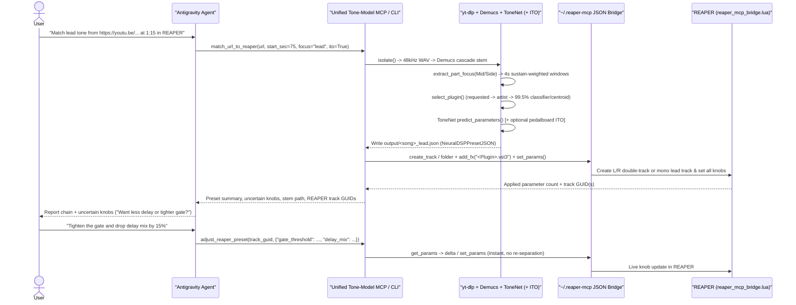

# Evaluation Audit & End-to-End URL → REAPER Implementation Plan

---

## Part 1: Are the `eval/` and `runs/` Results Favourable?

**Verdict: Cautiously favourable for practical preset matching (`runs/finetune`), under-trained on unconstrained synthetic settings (`runs/pretrain`), and not yet verified on rendered audio distance (`band_mae_db` / `mrstft`) or real commercial mixes (Tier 3).**

### 1.1 Training Dynamics (`runs/pretrain` vs. `runs/finetune`)

Both runs trained the 3-branch `ToneNet` (`hcqt` frontend, `z_dim=512`, `head_hidden=[512, 256]`) across all 7 guitar plugins on a CUDA GPU:

| Run | Checkpoint | Data & Scale | Epochs (Best) | Train → Val Loss | Val `mae` | Val `switch_acc` | Val `plugin_acc` | Val InfoNCE |
|---|---|---|---|---|---|---|---|---|
| **Stage 1 (`pretrain`)** | [best.pt](file:///c:/Users/devan/Desktop/IIIT/Research/Tone%20Parameter%20Estimation/runs/pretrain/best.pt) | `shards_v2/pretrain` (`500` grps = `2,000` clips/plugin, `source=0` random) | `18` (`ep 11`, early-stopped) | `1.425` → `1.196` | `0.224` | `59.98%` | `46.4%` (peak `49.2%`) | `1.845` → `1.726` |
| **Stage 2 (`finetune`)** | [best.pt](file:///c:/Users/devan/Desktop/IIIT/Research/Tone%20Parameter%20Estimation/runs/finetune/best.pt) | `shards_v2/finetune` (`6,224` train slots / `434` songs; `848` val slots / `61` held-out songs, `0` song overlap) | `30` (`ep 25`, still converging) | `0.871` → `0.543` (`ep 22`: `0.540`) | **`0.146`** | **`92.44%`** | **`99.53%`** (peak `99.71%`) | `2.060` → **`1.367`** |

### 1.2 Rigorous Baseline & Cross-Split Audit

Raw MAE and switch accuracy can be misleading when inactive/untranslated modules are masked or imbalanced. We evaluated [runs/pretrain/best.pt](file:///c:/Users/devan/Desktop/IIIT/Research/Tone%20Parameter%20Estimation/runs/pretrain/best.pt) and [runs/finetune/best.pt](file:///c:/Users/devan/Desktop/IIIT/Research/Tone%20Parameter%20Estimation/runs/finetune/best.pt) against two zero-audio constant baselines—**Plugin Defaults** (`schema.defaults()`) and **Train Mean/Mode Prior** (predicting each plugin's empirical training-split knob mean and most frequent switch class)—across **both** evaluation sets:

#### A. Held-Out Community/Song Presets — [eval/finetune_val/tier1.csv](file:///c:/Users/devan/Desktop/IIIT/Research/Tone%20Parameter%20Estimation/eval/finetune_val/tier1.csv) (`1,696` clips, `61` unseen songs)

| Plugin (`n` clips) | Plugin Defaults (`MAE` / `SwAcc`) | Train Mean/Mode Prior (`MAE` / `SwAcc`) | **`finetune/best.pt`** (`MAE` / `SwAcc`) | Net Gain vs. Train Prior (`ΔMAE` / `ΔSwAcc`) |
|---|---|---|---|---|
| **Archetype Abasi** (`268`) | `0.233` / `75.3%` | `0.173` / `82.7%` | **`0.147` / `92.3%`** | `-0.026` (`-15.0%` rel) / **`+9.6 pp`** |
| **Archetype Gojira** (`88`) | `0.208` / `83.2%` | `0.160` / `89.3%` | **`0.136` / `91.0%`** | `-0.024` (`-15.0%` rel) / **`+1.8 pp`** |
| **Archetype John Mayer X** (`268`) | `0.258` / `72.7%` | `0.171` / `86.4%` | **`0.145` / `93.7%`** | `-0.026` (`-15.4%` rel) / **`+7.3 pp`** |
| **Archetype Misha Mansoor X** (`268`) | `0.189` / `79.8%` | `0.172` / `85.9%` | **`0.152` / `93.3%`** | `-0.020` (`-11.8%` rel) / **`+7.4 pp`** |
| **Archetype Nolly X** (`268`) | `0.228` / `74.0%` | `0.176` / `85.6%` | **`0.154` / `93.3%`** | `-0.022` (`-12.6%` rel) / **`+7.7 pp`** |
| **Archetype Petrucci X** (`268`) | `0.247` / `82.1%` | `0.173` / `88.2%` | **`0.156` / `92.0%`** | `-0.016` (`-9.4%` rel) / **`+3.8 pp`** |
| **Archetype Plini** (`268`) | `0.206` / `79.1%` | `0.173` / `82.7%` | **`0.144` / `91.4%`** | `-0.028` (`-16.4%` rel) / **`+8.7 pp`** |
| **Overall (`1,696` clips)** | `0.226` / `77.5%` | `0.172` / `85.5%` | **`0.148` / `92.4%`** | **`-0.024` (`-14.0%` rel) / `+7.0 pp`** |

* **Plugin ID accuracy:** **`99.5%`** (`1,688 / 1,696` clips vs. `14.3%` random chance).

#### B. Unconstrained Random Synthetic Renders — [eval/pretrain_test/tier1.csv](file:///c:/Users/devan/Desktop/IIIT/Research/Tone%20Parameter%20Estimation/eval/pretrain_test/tier1.csv) (`1,120` clips)

| Predictor on `data/shards [test]` | `knob_mae` (↓) | `switch_acc` (↑) | `plugin_acc` (↑) | Per-Knob Pearson `r` (`675` knobs) |
|---|---|---|---|---|
| Plugin Defaults | `0.2310` | `55.60%` | — (`14.3%` chance) | — |
| Pretrain Mean/Mode Prior | `0.2234` | `55.25%` | — | `0.000` |
| **`runs/pretrain/best.pt`** | **`0.2225`** | **`59.90%`** | **`47.0%`** | mean `0.091` (`19%` of knobs `r > 0.30`) |
| **`runs/finetune/best.pt`** *(cross-eval)* | `0.2466` | `58.93%` | `40.8%` | mean `0.056` (`13%` of knobs `r > 0.30`) |

### 1.3 Key Takeaways: What Is Working vs. What Needs Attention

1. **Genuine audio-to-parameter learning on realistic presets (Favourable):**
   * Zero song leakage (`434` train songs vs. `61` val songs, `overlap = 0`).
   * On unseen songs' presets, `runs/finetune/best.pt` beats plugin defaults by **`-34.5%` MAE** (`0.226` → `0.148`, i.e., within ~1.5 ticks on a 0–10 knob) and cuts switch classification error **nearly in half** relative to the empirical training-distribution prior (`14.55%` error → `7.55%` error, `+7.0 pp` across all 7 plugins).
   * Contrastive disentanglement (`InfoNCE` `2.06` → `1.37` on unseen DI + unseen songs) and plugin classification (`99.5%`) converged cleanly with zero overfitting.

2. **Why `pretrain` underperformed & why `finetune` forgot secondary knobs (Unfavourable / Needs Care):**
   * **10× smaller pretraining set + smaller heads:** [render_dataset.py](file:///c:/Users/devan/Desktop/IIIT/Research/Tone%20Parameter%20Estimation/dataset_builder/render_dataset.py#L42) budgeted `5,000` groups (`20,000` clips) per plugin, and the architecture note specified `2048-1024-512` Stage-2 MLP heads. `shards_pretrain` only rendered **`500` groups (`2,000` clips) per plugin** with `head_hidden=[512, 256]`. With `43%` of parameters active simultaneously across `2^{15}` random switch combinations, `1,000` parameter draws per plugin was not enough to invert arbitrary multi-pedal combinations—so `pretrain` regressed low-salience knobs toward `~0.5` (`MAE 0.2225` vs. `0.2234` prior), learning mostly plugin identity (`47.0%`), routing switches (`+4.7 pp`), and the top `~19%` most audible knobs (`r > 0.3`).
   * **Sparse supervision & catastrophic forgetting in Stage 2:** `shards_finetune` is `81.8%` translated Katana/Boss GT/Mustang patches (`mask_frac = 12.7% – 20.6%`), where `Translation.known` only supervises the **Universal Chain** (`amp_type`, amp gain/bass/mid/treble/presence/master, and primary OD/mod/delay/reverb) and masks out graphic EQs, cab mic choices, room mics, and exotic FX. Consequently, `finetune` is accurate on core amp + primary pedal/time controls, while unmasked synthetic performance drifted (`0.2225` → `0.2466`).

> [!IMPORTANT]
> **Missing Perceptual Metrics (`band_mae_db: nan`, `mrstft: nan`) & Tier 2/3:** Both `eval/` tables were generated on cloud GPU without VST3 re-rendering. Because guitar signal chains are non-injective (e.g., overdrive level vs. amp gain, amp EQ vs. graphic EQ), knob MAE alone understates or overstates audible accuracy. Running local VST3 re-render evaluation + Tier 2 (`test` presets) + Tier 3 ([Songs.txt](file:///C:/Users/devan/Desktop/Music/Automated%20Neural%20DSP/Songs.txt)) on this machine—where all 8 `.vst3` plugins are licensed and installed—is the top verification priority, and **`runs/finetune/best.pt` is already strong enough to deploy in the REAPER pipeline today** (especially paired with `--ito` closed-loop refinement).

---

## Part 2: Implementation Plan — URL → `ToneNet` → REAPER Preset Pipeline

### 2.1 Existing Infrastructure Discovered on This Machine

All core building blocks already exist across two folders on your system, but are **not yet wired together into a single Antigravity workflow**:

* **Trained Model & Pipeline (`Tone Parameter Estimation`):** [pipeline/run_pipeline.py](file:///c:/Users/devan/Desktop/IIIT/Research/Tone%20Parameter%20Estimation/pipeline/run_pipeline.py) (`extract_tone_model`) and [pipeline/mcp_server.py](file:///c:/Users/devan/Desktop/IIIT/Research/Tone%20Parameter%20Estimation/pipeline/mcp_server.py) (`match_url_tone_model`), plus [runs/finetune/best.pt](file:///c:/Users/devan/Desktop/IIIT/Research/Tone%20Parameter%20Estimation/runs/finetune/best.pt) and [runs/finetune/centroids.npz](file:///c:/Users/devan/Desktop/IIIT/Research/Tone%20Parameter%20Estimation/runs/finetune/centroids.npz).
* **Licensed VST3s (`8/8` installed):** Verified in `C:\Program Files\Common Files\VST3` (`Abasi`, `Gojira`, `John Mayer X`, `Misha Mansoor X`, `Nolly X`, `Petrucci X`, `Plini`, `Mantra`).
* **REAPER Bridge & Driver:** [reaper_mcp_bridge.lua](file:///C:/Users/devan/AppData/Roaming/REAPER/Scripts/reaper_mcp_bridge.lua) is already installed in `%APPDATA%\REAPER\Scripts\`, watching `C:\Users\devan\.reaper-mcp`. [reaper_driver.py](file:///C:/Users/devan/Desktop/Music/Automated%20Neural%20DSP/neural-tone-mcp/src/daw/reaper_driver.py) in `neural-tone-mcp` already creates tracks/folders, inserts `<Plugin>.vst3`, matches parameter `host_name`s, and writes normalized `0..1` values.
* **Environment Bottleneck Found:** `Tone Parameter Estimation\.venv` currently has **CPU-only PyTorch** (`2.14.1+cpu`), which runs slowly and hits the Windows CPU wide-`Conv2d` hang noted in [README.md](file:///c:/Users/devan/Desktop/IIIT/Research/Tone%20Parameter%20Estimation/README.md#L335-L336), whereas your machine **has an NVIDIA GPU** (verified CUDA `True` in `neural-tone-mcp\.venv-gpu` with `torch 2.11.0+cu128`). Also, `C:\Users\devan\.gemini\config\mcp_config.json` is currently `0` bytes.

### 2.2 End-to-End Architecture (From User URL to Live Tweaking in REAPER)



### 2.3 Step-by-Step Implementation Plan

#### Phase A: Fix Local GPU Runtime & Checkpoint Defaults
1. **Upgrade `.venv` to CUDA PyTorch + Thread Guard:**
   * Install CUDA-enabled `torch` / `torchaudio` (`cu128`) into `Tone Parameter Estimation\.venv` so Demucs separation + `ToneNet` HCQT inference run on GPU (~4–6 s total instead of minutes on CPU) and completely bypass the Windows CPU `Conv2d` hang. Set `OMP_NUM_THREADS=1` as a fallback guard.
2. **Pin Absolute Default Paths in [common/paths.py](file:///c:/Users/devan/Desktop/IIIT/Research/Tone%20Parameter%20Estimation/common/paths.py) & [pipeline/run_pipeline.py](file:///c:/Users/devan/Desktop/IIIT/Research/Tone%20Parameter%20Estimation/pipeline/run_pipeline.py):**
   * Change `DEFAULT_CHECKPOINT` in [run_pipeline.py](file:///c:/Users/devan/Desktop/IIIT/Research/Tone%20Parameter%20Estimation/pipeline/run_pipeline.py#L30) from relative `Path("runs/exp/best.pt")` (non-existent) to `ROOT / "runs/finetune/best.pt"` so CLI and MCP invocations work regardless of working directory.
   * Clamp secondary/unsupervised knobs safely: verify `to_preset()` in [infer.py](file:///c:/Users/devan/Desktop/IIIT/Research/Tone%20Parameter%20Estimation/tone_parameter_estimation/infer.py#L168-L185) only emits active parameters (`pred.mask` + `pinned`), leaving inactive modules cleanly bypassed at REAPER's plugin defaults (already implemented—verify with a round-trip test!).

#### Phase B: Port REAPER Driver & Interactive Preset Adjustment into `Tone Parameter Estimation`
Rather than forcing two separate Python environments (`Tone Parameter Estimation` + `neural-tone-mcp`) to run simultaneously, add a self-contained `pipeline/reaper_driver.py` (ported cleanly from [neural-tone-mcp/src/daw/reaper_driver.py](file:///C:/Users/devan/Desktop/Music/Automated%20Neural%20DSP/neural-tone-mcp/src/daw/reaper_driver.py) and `base.py`, adapted to [common/schema.py](file:///c:/Users/devan/Desktop/IIIT/Research/Tone%20Parameter%20Estimation/common/schema.py)) and extend [pipeline/run_pipeline.py](file:///c:/Users/devan/Desktop/IIIT/Research/Tone%20Parameter%20Estimation/pipeline/run_pipeline.py) + [pipeline/mcp_server.py](file:///c:/Users/devan/Desktop/IIIT/Research/Tone%20Parameter%20Estimation/pipeline/mcp_server.py):

1. **Create `pipeline/reaper_driver.py`:**
   * `ping_reaper()` → checks `C:\Users\devan\.reaper-mcp` (`reaper_mcp_bridge.lua` status) with a clear actionable error if REAPER or the Lua script isn't running.
   * `apply_preset_to_reaper(json_path, import_stem=False, di_path=None)`:
     * If `double_tracked=True` (`rhythm` focus with stereo width > `0.2`), creates a parent folder track + hard-panned `L (-100)` / `R (+100)` child tracks, loads `<Plugin>.vst3` on `L`, applies all normalized `vst_parameters` matched by `host_name`, and copies exact binary FX chain state to `R` (`get_chain` → `set_chain`).
     * If `double_tracked=False` (`lead` / mono), creates a single track and applies all parameters.
     * *(Optional flag)* Imports either your reference DI (`Single Coil.wav`) onto the guitar track or imports the isolated `guitar_stem.wav` onto a muted reference track right next to it in REAPER for instant A/B listening!
   * `tweak_reaper_parameters(track_guid_or_name, updates, fx_slot=0)`:
     * Reads current normalized/display values from REAPER (`get_params`), converts human units or `[0, 1]` deltas via `PluginSchema`, and calls `set_params`—enabling conversational follow-ups like *"add 20% more reverb mix and switch overdrive on"* in <100 ms!
   * `list_reaper_tracks()` → inspects current REAPER project tracks, FX slots, and parameter values so the agent can adjust *existing* tracks too.

2. **Add `--apply-reaper` CLI flag to [pipeline/run_pipeline.py](file:///c:/Users/devan/Desktop/IIIT/Research/Tone%20Parameter%20Estimation/pipeline/run_pipeline.py):**
   * Example one-liner:
     ```powershell
     python -m pipeline.run_pipeline "https://youtu.be/..." --start 60 --duration 25 --focus lead --ito --apply-reaper
     ```

3. **Upgrade [pipeline/mcp_server.py](file:///c:/Users/devan/Desktop/IIIT/Research/Tone%20Parameter%20Estimation/pipeline/mcp_server.py) with 5 End-to-End MCP Tools:**
   * `match_url_to_reaper(...)`: Full pipeline (`URL/file` → `Demucs` → `ToneNet` → optional `ITO` → `JSON` → `REAPER` tracks & FX parameters) in one tool call.
   * `match_url_tone_model(...)`: Generates preset JSON + preview/check without touching REAPER.
   * `apply_tone_json_to_daw(json_path, import_stem=False)`: Pushes any saved preset JSON into REAPER.
   * `adjust_reaper_plugin_params(track, param_updates, plugin_name=None)`: Tweaks individual knobs/switches live in REAPER using schema names or display units (dB, ms, Hz, enum labels).
   * `get_reaper_track_tone_state(track)`: Reads back current live knob positions from REAPER + schema metadata so I can see manual tweaks you made in the plugin GUI before adjusting further.

#### Phase C: Register MCP Server + Workspace Skill in Antigravity
1. **Configure Global MCP (`C:\Users\devan\.gemini\config\mcp_config.json`):**
   ```json
   {
     "mcpServers": {
       "tone-model": {
         "command": "c:\\Users\\devan\\Desktop\\IIIT\\Research\\Tone Parameter Estimation\\.venv\\Scripts\\python.exe",
         "args": ["-m", "pipeline.mcp_server"],
         "env": {
           "PYTHONPATH": "c:\\Users\\devan\\Desktop\\IIIT\\Research\\Tone Parameter Estimation",
           "TONE_CHECKPOINT": "c:\\Users\\devan\\Desktop\\IIIT\\Research\\Tone Parameter Estimation\\runs\\finetune\\best.pt",
           "OMP_NUM_THREADS": "1"
         }
       }
     }
   }
   ```
   > [!WARNING]
   > Because `reaper_mcp_bridge.lua` uses single-file polling (`~/.reaper-mcp/request.json`), never invoke a separate `reaper` MCP server concurrently with `apply_tone_json_to_daw` / `adjust_reaper_plugin_params`.

2. **Add Workspace Skill (`.agents/skills/reaper-tone-matcher/SKILL.md`):**
   * Teaches Antigravity the exact conversational protocol whenever you drop a YouTube/audio link:
     1. Parse timestamp (`start_sec`), section (`rhythm` vs. `lead` vs. both), artist/plugin hints, and whether to run `--ito` (recommended when high accuracy matters; ~15–25 s extra for 96 plugin renders).
     2. Ensure REAPER + `reaper_mcp_bridge.lua` is responding (`ping_reaper()`).
     3. Run `match_url_to_reaper` (once for `rhythm`, once for `lead` if you ask for a full song rig, grouping them into a song folder in REAPER).
     4. Report the selected plugin, amp channel, active pedals, and `Least certain knobs (±spread)`, then offer targeted live tweaks via `adjust_reaper_plugin_params`.

---

## Part 3: What To Do Next (Prioritized Roadmap)

| Priority | Action | Why It Matters | Effort |
|---|---|---|---|
| **P0 (Immediate)** | **Upgrade `.venv` to CUDA + wire `pipeline/reaper_driver.py` + `mcp_config.json`** | Enables the full *"give me a URL → I dial it in REAPER"* workflow with GPU Demucs/ToneNet speed (~5 s). | ~30 min |
| **P1 (Verify Real Audio)** | **Run Local Acoustic Eval (Tier 1 `--render`, Tier 2 unseen `test` presets, Tier 3 [Songs.txt](file:///C:/Users/devan/Desktop/Music/Automated%20Neural%20DSP/Songs.txt))** | Fills in the `nan` `band_mae_db` and `mrstft` columns using your licensed VST3s, benchmarks against plugin defaults & `neural-tone-mcp` heuristics, and generates `reaper_session.json` for listening on your 6 benchmark songs. | ~45 min |
| **P2 (Inference Accuracy Boost — Zero Retraining)** | **Enable `--ito` (ST-ITO) on core active knobs by default for REAPER matching** | Since `finetune/best.pt` already gets within `0.148` MAE (`92.4%` switch accuracy), 8–12 generations of closed-loop `pedalboard` rendering (`ito_refine`) fixes the remaining EQ/gain offset against the song stem without needing a new training run. | Built-in (`--ito`) |
| **P3 (Next Model Iteration — `v3`)** | **1. Scale `shards_pretrain` (`500` → `3,000+` groups/plugin) using [runs/finetune/fx_probs.json](file:///c:/Users/devan/Desktop/IIIT/Research/Tone%20Parameter%20Estimation/runs/finetune/fx_probs.json)**<br>**2. Mix `25%` synthetic renders (`source=0`) into Stage 2 fine-tuning**<br>**3. Enable `augment.stem_roundtrip` (mix + Demucs re-separation) on `20%` of shards** | 1. Fixes Stage-1 underfitting on multi-FX routing.<br>2. Prevents catastrophic forgetting on graphic EQ / cab mic / secondary FX knobs that Katana/GT translations mask out.<br>3. Closes the domain gap to Demucs-separated YouTube stems. | Overnight local render + 2 hr cloud GPU |
